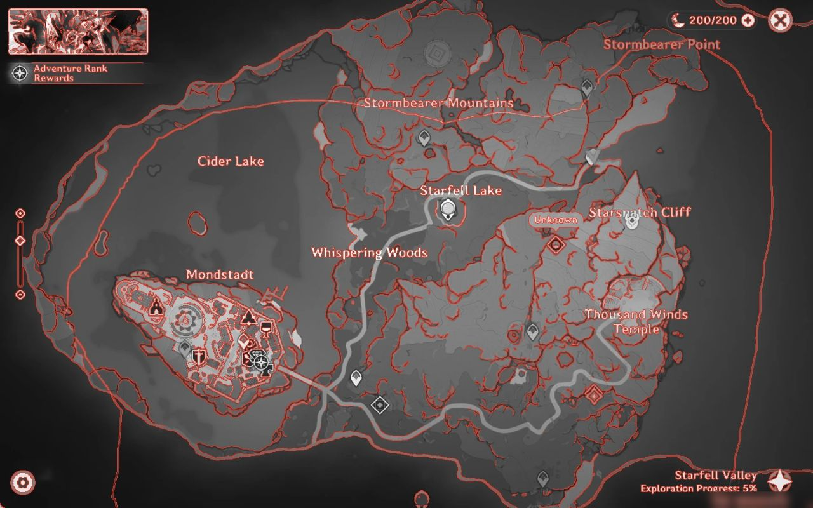
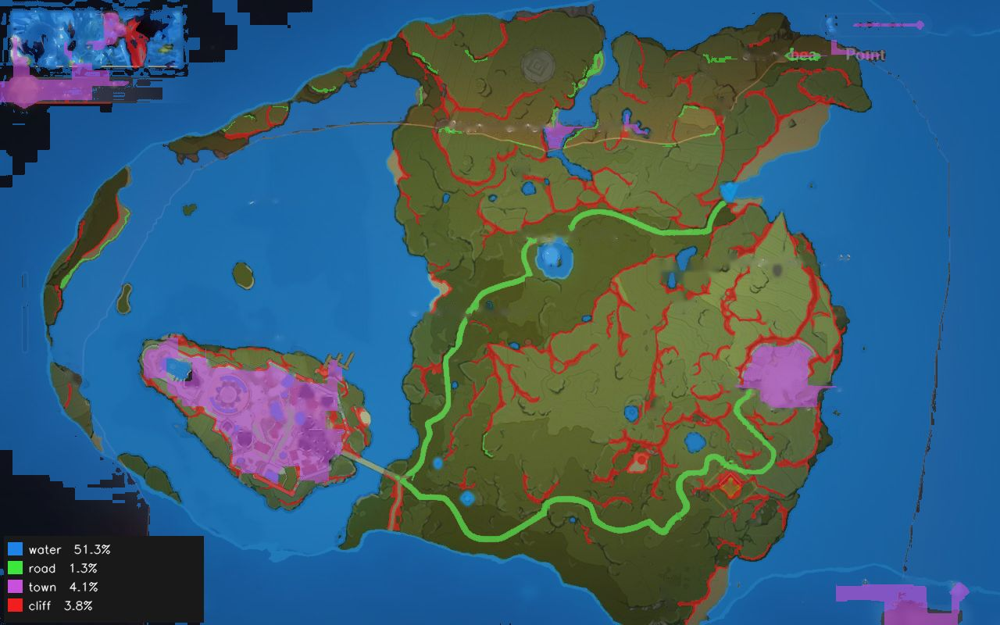
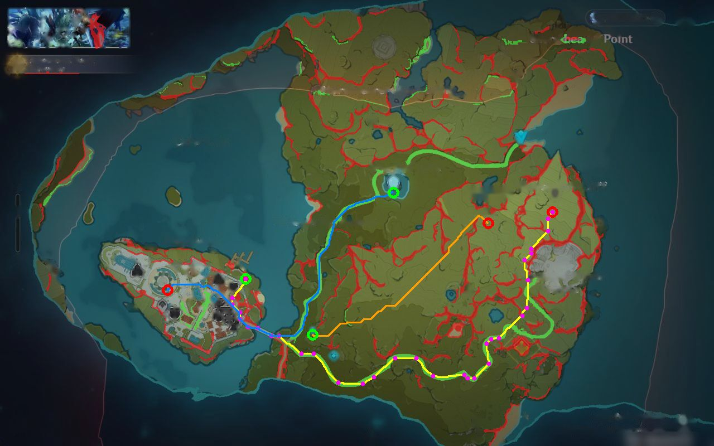
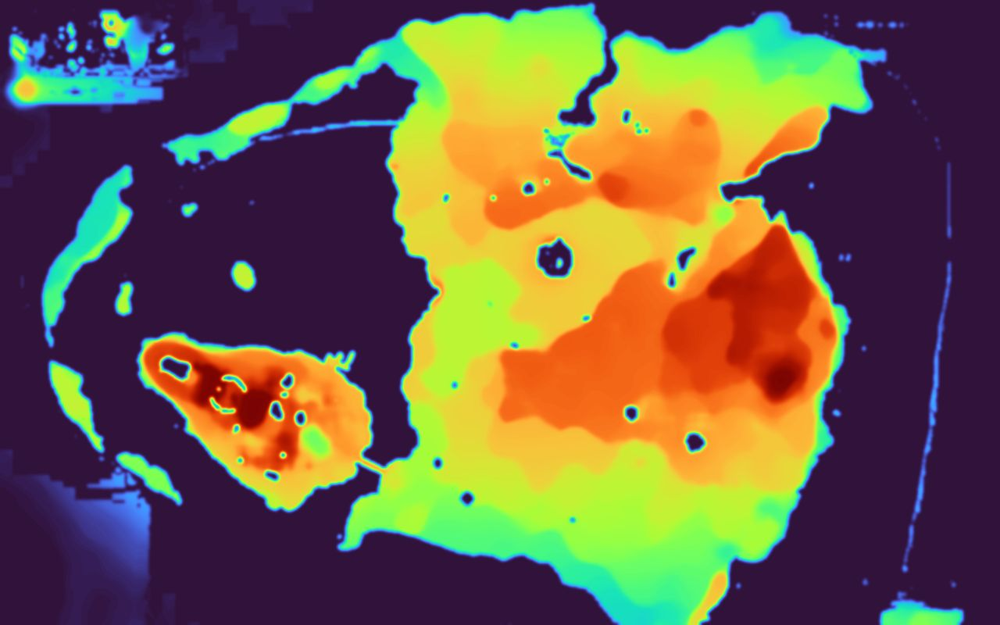
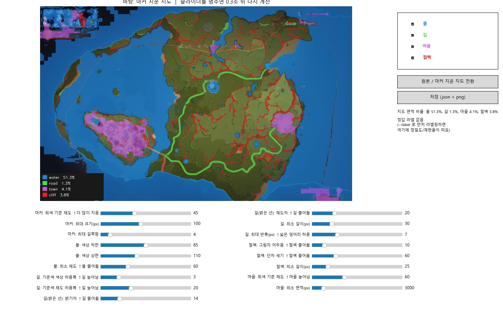
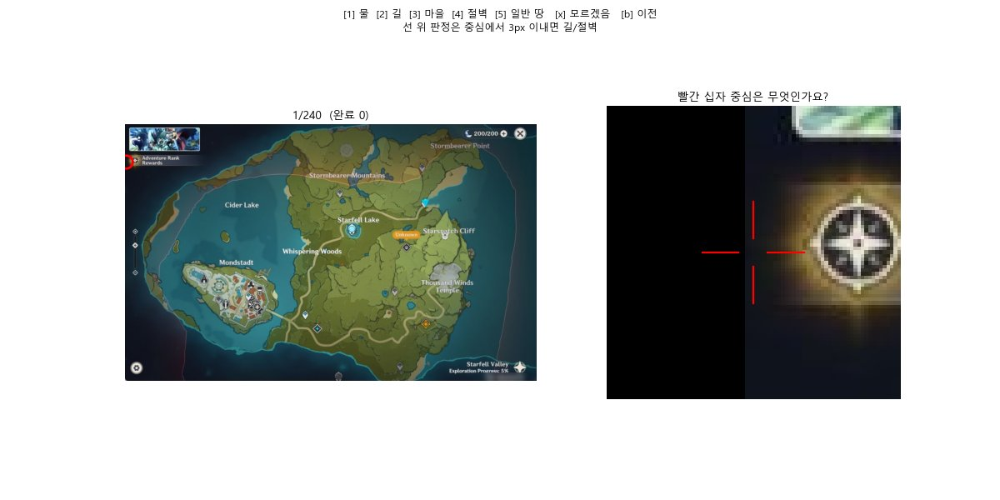
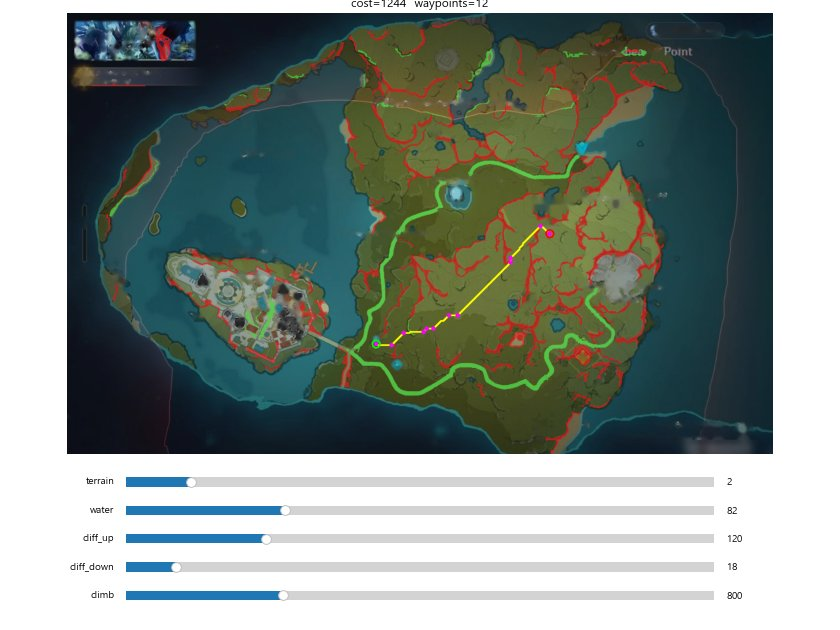
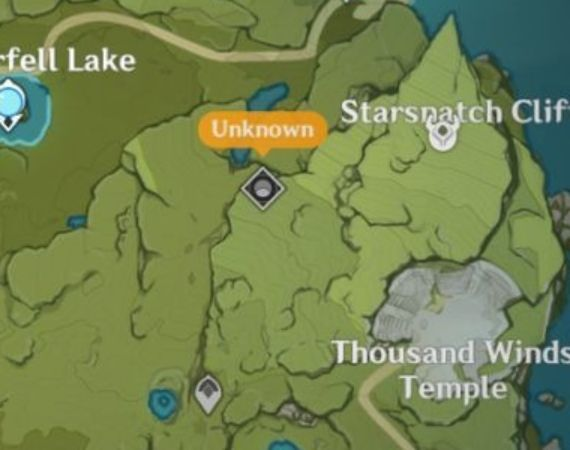
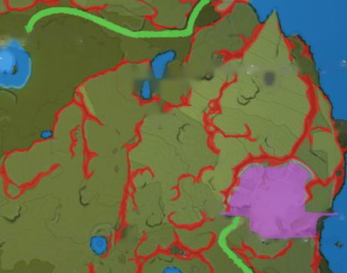

# Genshin Map Contour

원신 지도 스크린샷(RGB) 한 장에서 **물·길·마을·절벽·상대 고도**를 분리하고, 그 위에서 **오르막과 내리막 비용이 다른 경로**를 찾습니다.
인식 결과를 색으로 보고 슬라이더로 조정할 수 있고, 직접 단 정답으로 **정밀도와 재현율**을 확인할 수 있습니다.

| 기존: grayscale + Canny contour | 지금: 클래스별 레이어 |
|---|---|
|  |  |
| 지명 글자, 지역 경계선, 바다 경계선까지 벽으로 잡힘 | 🟦 물 · 🟩 길 · 🟪 마을 · 🟥 절벽 (글자와 마커는 지운 뒤 인식) |

| 경로 예시 | 상대 고도 (빨강 = 높음) |
|---|---|
|  |  |
| 노랑: Mondstadt → 동쪽 고원, 파랑: Starfell Lake → Mondstadt 시내, 주황: 숲 → Unknown | 밝기를 그대로 고도로 쓰지 않고, 글자와 길을 지운 뒤 크게 평활화한 추정치 |

- 경로 계산: **0.16초** (기존 Lazy Theta* 3.6초)
- 레이어 생성: 처음 약 4초, 이후 캐시를 쓰면 0.08초

## 목차

- [빠른 시작](#빠른-시작)
- [저장소 구성](#저장소-구성)
- [명령어](#명령어)
- [내 지도로 쓰기](#내-지도로-쓰기)
- [출력 파일과 설정 파일](#출력-파일과-설정-파일)
- [인식이 맞는지 확인하는 법](#인식이-맞는지-확인하는-법)
- [무엇이 문제였고 어떻게 바꿨나](#무엇이-문제였고-어떻게-바꿨나)
- [처리 순서](#처리-순서)
- [슬라이더 설명](#슬라이더-설명)
- [경로 비용 (COST)](#경로-비용-cost)
- [문제 해결](#문제-해결)
- [한계와 다음 단계](#한계와-다음-단계)

---

## 빠른 시작

```bash
git clone https://github.com/rrrr66254/Genshin_Map_Contour.git
cd Genshin_Map_Contour
pip install -r requirements.txt

# 1) 샘플 지도로 인식 결과 저장 (samples/starfell_valley_*.png 생성)
python map_terrain.py samples/starfell_valley.jpg

# 2) 두 지점 사이 경로 (samples/starfell_valley_path.png 생성)
python map_terrain.py samples/starfell_valley.jpg --from 440,500 --to 990,380
```

- Python 3.9 이상이면 됩니다. Windows, Python 3.14에서 확인했습니다.
- 실행할 때마다 self-check가 먼저 돌고 `selfcheck ok`가 나오면 정상입니다.
- 모든 명령은 clone한 폴더(`Genshin_Map_Contour`) 안에서 실행합니다.
- 좌표는 지도 이미지의 픽셀 좌표(x, y)입니다. 왼쪽 위가 (0, 0)입니다.

## 저장소 구성

```
Genshin_Map_Contour/
├── map_terrain.py          # 코드 전부 (인식, 경로탐색, 튜너, 라벨링, 평가)
├── requirements.txt        # numpy, scipy, opencv-python-headless, matplotlib
├── samples/
│   └── starfell_valley.jpg # 샘플 지도 (1280×800, UID 흐림 처리)
└── docs/                   # README 그림
```

`map_terrain.py`의 주요 함수:

| 함수 | 하는 일 |
|---|---|
| `build_layers(path)` | 지도 파일 → 레이어 dict (캐시 사용) |
| `detect(bgr)` | 이미지 배열 → 레이어 dict (캐시 없이) |
| `plan(L, start, goal)` | 경로 좌표, 총 비용, waypoint 반환. 갈 수 없으면 `(None, inf, None)` |
| `render_labels(L)` | 클래스별 색 + 범례 이미지 |
| `evaluate(L, gt)` | 정답 점 대비 정밀도·재현율·혼동행렬 |
| `DETECT`, `COST` | 인식 값과 경로 비용 (dict, 실행 중에 바꿔도 됨) |

## 명령어

| 명령 | 하는 일 |
|---|---|
| `python map_terrain.py MAP` | 레이어 PNG 저장: `_water`, `_road`, `_town`, `_cliff`, `_altitude`, `_labels` |
| `... MAP --from x,y --to x,y` | 경로를 계산해서 비용과 waypoint를 출력하고 `_path.png` 저장 |
| `... MAP --tune-detect` | **인식률 튜너.** 슬라이더로 인식 값 조정. 저장을 누르면 `map_detect.json`에 저장 |
| `... MAP --label` | **정답 라벨링.** 무작위 점 240개에 정답을 답함. `MAP.gt.json`에 저장 |
| `... MAP --eval` | 현재 인식 값의 정밀도·재현율·혼동행렬 출력 |
| `... MAP --tune` | **경로 비용 튜너.** 왼쪽 클릭 = 출발, 오른쪽 클릭 = 도착 |

코드에서 쓰는 방법:

```python
import map_terrain as mt
L = mt.build_layers("samples/starfell_valley.jpg")   # dict: water, road, town, cliff, altitude, clean, ui
path, cost, waypoints = mt.plan(L, (440, 500), (990, 380))
```

### 인식률 튜너 (`--tune-detect`)


- 슬라이더를 멈추면 0.3초 뒤 다시 계산합니다.
- 체크박스로 클래스를 켜고 끌 수 있고, "원본 / 마커 지운 지도 전환" 버튼으로 바탕을 바꿉니다.
- 정답 라벨(`MAP.gt.json`)이 있으면 오른쪽 패널에 정밀도·재현율이 실시간으로 뜹니다.
- **저장**을 누르면 `map_detect.json`에 저장되고, 이후 모든 실행이 이 값을 씁니다.

### 정답 라벨링 (`--label`)


- 키: `1` 물 · `2` 길 · `3` 마을 · `4` 절벽 · `5` 일반 땅 · `x` 모르겠음(게임 UI 위의 점 포함) · `b` 이전
- **검출 결과는 숨겨서** 답이 거기에 끌려가지 않게 했습니다.
- 길이나 절벽은 십자 중심에서 3px 이내면 그 선 위로 봅니다.
- 키를 누를 때마다 저장되므로 중간에 닫아도 이어서 할 수 있습니다. 한 점에 2~3초, 전체 10분 안쪽입니다.

### 경로 비용 튜너 (`--tune`)


정한 값은 `map_terrain.py` 맨 위의 `COST`에 붙여넣으면 됩니다. 터미널에 매번 출력됩니다.

---

## 내 지도로 쓰기

1. 게임에서 지도(M)를 열고 **화면 전체를 스크린샷**합니다. 원본 컬러 그대로 저장합니다(PNG 또는 JPG).
2. 어디에 저장해도 됩니다. 한글이나 공백이 있는 경로도 됩니다(따옴표로 감싸기).
3. 샘플 대신 그 경로를 넣어 실행합니다.
   ```bash
   python map_terrain.py "내지도.png"
   python map_terrain.py "내지도.png" --tune-detect
   ```
4. 출발·도착 좌표는 결과 PNG(`내지도_labels.png`)를 그림판 등으로 열어서 마우스 위치의 픽셀 좌표를 읽으면 됩니다. `--tune`에서는 클릭으로 바로 정할 수 있습니다.

- 인식 값(`DETECT`)은 1280×800 샘플 기준으로 맞춰져 있습니다. 해상도나 줌이 많이 다르면 `--tune-detect`에서 먼저 확인하세요. 길이·크기 값(`*_min_len`, `*_max_side`, `town_min_area`)은 해상도에 비례해서 조정합니다.
- 지도 줌 단계가 바뀌면 길 굵기와 절벽 그림자 폭도 바뀝니다. 같은 줌으로 찍은 스크린샷끼리는 같은 설정을 그대로 쓸 수 있습니다.

## 출력 파일과 설정 파일

| 파일 | 언제 생기나 | 내용 |
|---|---|---|
| `<지도>_water.png` 등 | 기본 실행 | 클래스별 흑백 마스크 (`_water`, `_road`, `_town`, `_cliff`, `_ui`) |
| `<지도>_altitude.png` | 기본 실행 | 상대 고도 컬러맵 |
| `<지도>_labels.png` | 기본 실행, 튜너 저장 | 클래스별 색 + 범례 |
| `<지도>_path.png` | `--from --to` | 경로(노랑)와 waypoint(분홍) |
| `<지도>.layers.v4.<해시>.npz` | 첫 실행 | 레이어 캐시. 지도나 인식 값이 바뀌면 새로 만듦 |
| `<지도>.gt.json` | `--label` | 정답 점 (좌표, 정답, 가중치) |
| `map_detect.json` | 튜너에서 **저장** | 인식 값. `map_terrain.py`와 같은 폴더에 생기고, 이후 모든 실행이 자동으로 읽음 |

- 인식 값을 처음 상태로 되돌리려면 `map_detect.json`을 지우면 됩니다.
- 캐시(`.npz`), 결과 PNG, 정답 파일은 `.gitignore`에 들어 있어 커밋되지 않습니다. 팀원과 정답이나 설정을 공유하려면 `git add -f`로 직접 추가하세요.

---

## 인식이 맞는지 확인하는 법

1. `--label`로 점 240개에 정답을 답합니다.
2. `--eval`로 점수를 봅니다.
3. `--tune-detect`에서 점수가 낮은 클래스의 슬라이더를 움직여, 점수가 오르는 쪽을 찾습니다.
4. 저장한 뒤 `--eval`로 다시 확인합니다. 정답 파일은 그대로 다시 쓸 수 있습니다.

| 점수 | 뜻 | 낮으면 |
|---|---|---|
| 정밀도 | "절벽"이라고 검출한 곳 중 진짜 절벽의 비율 | 엉뚱한 곳을 절벽으로 잡음 (오검출) |
| 재현율 | 진짜 절벽 중 검출한 비율 | 절벽을 놓침 (누락) |
| 혼동행렬 | 행 = 정답, 열 = 검출 | 예: "일반 땅 → 절벽" 칸이 크면 그림자를 절벽으로 착각하는 것 |

길과 절벽은 지도 면적이 작아서, 클래스마다 점을 40개씩(일반 땅은 80개) 따로 뽑습니다. 각 점이 지도에서 차지하는 비중을 가중치로 반영하므로, 점수는 실제 면적 비율대로 계산됩니다. 인식 값을 바꾼 뒤에도 같은 정답 파일로 계속 평가할 수 있습니다.

---

## 무엇이 문제였고 어떻게 바꿨나

| 문제 | 원인 | 지금 방식 |
|---|---|---|
| 글자가 벽이 됨 | 흰 글자 + 어두운 외곽선이 Canny에서 강한 edge가 됨 | 흰 글자와 마커를 마스크로 찾아서 inpaint로 지운 뒤 인식 |
| 지역·바다 경계선이 벽이 됨 | 모든 밝기 변화를 edge로 잡음 | 절벽은 **주변보다 어두운** 띠만 인정. 밝은 경계선은 제외 |
| 밝기 ≠ 고도 | 지도 음영은 hillshade와 지면 색이 섞인 것 | 밝기는 상대 고도 추정에만 쓰고, 경로 판단은 절벽 선과 고도차로 함 |
| 절벽 누락 | 절벽 대부분이 넓은 그림자 띠나 단차로 그려짐 | blackhat(그림자 띠)과 밝기 기울기(단차)를 함께 쓰고, 짧은 조각은 버림 |
| Unknown 배지·핀이 장애물이 됨 | 마커를 지우지 않음 | 작고 둥근 회색·흰색·주황 덩어리는 마커로 보고 지움 |
| 고원 위 길·다리 누락 | 밝은 바탕에서는 길 색이 기준 색과 달라짐 | 기준 색 매칭에 더해, 주변보다 밝고 채도가 낮은 가는 선도 길로 봄 |
| 해변·풀밭이 길로 잡힘 | 길과 색이 비슷함 | 폭이 넓거나 길쭉하지 않은 덩어리는 길에서 제외 |
| 도시 전체가 벽 | 건물 윤곽이 다 edge로 잡힘 | 넓은 회색 영역은 마을로 보고, 바깥 성벽만 절벽으로 남김 |

| Unknown 주변 원본 | 같은 곳의 인식 결과 |
|---|---|
|  |  |

## 처리 순서

1. **마커 제거:** 지명 글자, 핀, 웨이포인트, 주황 배지를 찾아 inpaint로 지움
2. **물:** 파란 색상 범위와 최소 채도로 찾음
3. **길:** PPT의 길 색 7개와 매칭하고, 밝은 가는 선 검출을 더함. 넓은 덩어리는 버림
4. **마을:** 넓은 저채도 영역을 찾고, 가장자리를 깎아 성벽은 남김
5. **절벽:** 그림자 띠와 단차를 찾음. 길·물 가장자리와 마을 안쪽은 제외
6. **상대 고도:** 지면 밝기를 크게 평활화해 0~1로 만들고, 물은 0
7. **경로:** 8방향 격자에서 방향 있는 Dijkstra. 오르막은 비싸고, 내리막(점프·활공)은 쌈. 그래서 같은 두 지점이라도 방향에 따라 비용이 다름

## 슬라이더 설명

튜너에도 같은 한글 이름으로 나옵니다. ↑는 값을 올렸을 때의 변화입니다.

| 그룹 | 슬라이더 (설정 키) | 의미 |
|---|---|---|
| 마커 | 회색 기준 채도 `ui_sat` | 이보다 색이 흐리면 마커 후보. ↑ 더 많이 지움 |
| | 최대 크기 `ui_max_side` | 이보다 크면 마커가 아님 (도시, 사원 보호) |
| | 최대 길쭉함 `ui_max_elong` | 이보다 길쭉하면 마커가 아님 (해변 보호) |
| 물 | 색상 하한·상한 `water_hue_lo/hi` | 물로 볼 파란색 범위 (OpenCV hue 0~180) |
| | 최소 채도 `water_sat` | ↑ 진한 파랑만 물 |
| 길 | 기준색 허용폭 `road_hue_tol`, `road_sat_tol` | PPT 길 색과 얼마나 달라도 길로 볼지. ↑ 길 늘어남 |
| | 밝은 선 기준 `road_bright`, `road_desat` | 주변보다 얼마나 밝고 흐려야 길인지. ↑ 길 줄어듦 |
| | 최소 길이 `road_min_len` | 이보다 짧은 선은 길이 아님 (px) |
| | 최대 반폭 `road_max_halfw` | 이보다 넓은 덩어리는 해변·풀밭 (px) |
| 절벽 | 그림자 어두움 `cliff_dark` | 주변보다 얼마나 어두운 띠를 절벽으로 볼지. ↑ 절벽 줄어듦 |
| | 단차 세기 `cliff_step` | 밝기가 얼마나 급하게 바뀌어야 고원 경계인지. ↑ 절벽 줄어듦 |
| | 최소 길이 `cliff_min_len` | 이보다 짧은 조각은 버림 (px) |
| 마을 | 회색 기준 채도 `town_sat` | ↑ 마을로 보는 영역 늘어남 |
| | 최소 면적 `town_min_area` | 이보다 작은 회색 영역은 마을이 아님 (px²) |

## 경로 비용 (`COST`)

| 키 | 기본값 | 의미 |
|---|---|---|
| `road` | 1 | 길 1px 이동 비용 |
| `terrain` | 2 | 일반 땅 1px. ↑ 길을 더 따라감 |
| `water` | 82 | 물 1px (수영). ↑ 물을 더 피함 |
| `cliff_up` | 120 | 절벽을 **오를 때** 1px당 추가 비용 |
| `cliff_down` | 18 | 절벽을 **내려갈 때**(점프·활공) 1px당 추가 비용 |
| `climb` | 800 | 상대 고도가 오른 만큼 붙는 비용 |

## 문제 해결

| 증상 | 원인과 해결 |
|---|---|
| 튜너 창이 안 뜸 | 창은 matplotlib(Tk)로 띄웁니다. `python -c "import tkinter"`가 실패하면 Python을 Tk 포함으로 다시 설치하세요. OpenCV 창은 쓰지 않으므로 headless OpenCV여도 됩니다 |
| 튜너 글자가 □로 나옴 | 한글 폰트가 없는 경우입니다. Windows는 맑은 고딕을 자동으로 씁니다. macOS는 AppleGothic, Linux는 `fonts-nanum`을 설치하세요 |
| `Numpy built with MINGW-W64 ... experimental` 경고 | 일부 Windows용 numpy 빌드가 내는 경고이고 결과에는 영향이 없습니다. 거슬리면 `pip install --force-reinstall numpy` |
| `selfcheck` 실패(AssertionError) | 코드나 `map_detect.json` 값이 극단적으로 바뀐 경우입니다. `map_detect.json`을 지우고 다시 실행하세요 |
| 지도를 바꿨는데 결과가 그대로 | 캐시는 파일 수정 시간으로 구분합니다. 같은 이름으로 덮어썼는데 이상하면 `.npz`를 지우세요 |
| 경로가 `cost=inf` | 출발이나 도착이 물·UI 박스 위이거나 막힌 곳입니다. 좌표를 땅 위로 옮기거나 `--tune`에서 `water`, `cliff_up`을 낮춰 보세요 |
| `--eval`이 "정답 라벨 없음" | 먼저 `--label`로 같은 지도에 라벨링해야 합니다. 정답 파일은 지도 파일 이름 기준(`<지도>.gt.json`)입니다 |

## 한계와 다음 단계

- **고도는 추정치입니다.** 원래 밝은 색(사원, 길 주변)은 실제보다 높게 나올 수 있습니다. 실제 플레이 궤적이나 게임 내 높이 값으로 보정하는 게 다음 단계입니다.
- **고원 안쪽 작은 그림자**까지 절벽으로 잡혀 절벽이 다소 많습니다. `cliff_dark`와 `cliff_step`으로 조정합니다.
- **마을 오검출:** 화면 모서리의 게임 UI 박스와 Stormbearer 경계 일부가 마을로 잡힙니다. `town_min_area`로 조정합니다.
- **계단 모양 경로:** 8방향 격자라서 경로가 계단 모양으로 그려집니다. 이동에는 waypoint(`approxPolyDP`로 줄인 점)를 쓰면 됩니다.
- **단일 스크린샷 기준:** 지금은 지도 한 화면에서 동작합니다. 최대 줌 타일을 이어 붙인 전체 지도를 넣으면 같은 함수가 그대로 동작합니다.
- 샘플 지도의 UID는 흐리게 처리했습니다.
